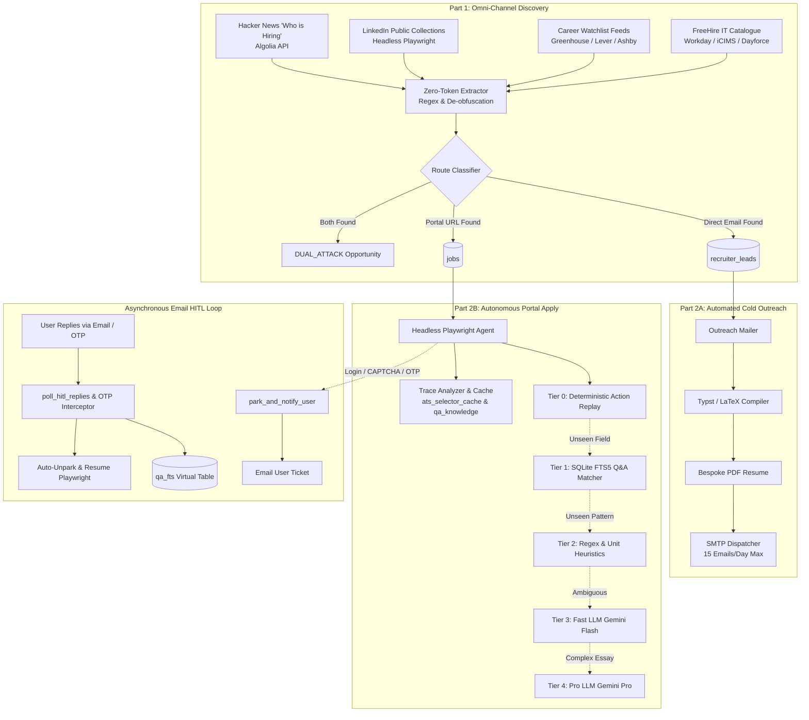

# ApplyPilot

**Autonomous Omni-Channel Job Discovery, Cold Outreach & Browser-Driven Application Agent**

[](https://www.python.org/downloads/)
[](https://playwright.dev/)
[](https://modelcontextprotocol.io/)
[](LICENSE)
[](tests/)

ApplyPilot is an end-to-end, multi-channel autonomous hiring assistant. It executes the **Dual-Attack Strategy**: discovering thousands of open engineering roles across social platforms and enterprise ATS boards, extracting direct founder and recruiter emails, dispatching personalized cold email pitches with tailored PDF resumes, and autonomously completing complex web application forms via a **5-Tier Zero-Token Learning Engine** in headless Playwright.

---

## 🏛️ System Architecture



---

## 🌟 Key Capabilities & Innovations

### 1. The Dual-Attack Strategy
Standard job bots only submit ATS forms that get lost in candidate resume piles. ApplyPilot implements the **Dual-Attack Strategy**:
- **Route 1 (`EMAIL_ONLY`)**: For social posts containing published recruiter/founder emails, it compiles tailored resumes and dispatches high-conversion cold emails directly to decision-makers.
- **Route 2 (`PORTAL_ONLY`)**: For enterprise career portals, it launches headless Playwright to complete form fields autonomously.
- **Route 3 (`DUAL_ATTACK`)**: When both an official portal URL and a direct email exist, ApplyPilot simultaneously applies through the portal AND sends an email pitch to the hiring team noting the application was submitted.

### 2. Zero-Cookie Social Harvesting
ApplyPilot operates under a strict **Zero-Cookie Policy**:
- **LinkedIn Public Scraper**: Uses headless Playwright to monitor public guest collections (`/jobs/remote-software-engineer-jobs`, `/jobs/backend-engineer-jobs`) with **zero account credentials**, eliminating account ban risks.
- **Hacker News Harvester**: Queries the public Algolia API to analyze monthly "Ask HN: Who is Hiring?" threads, extracting verified founder emails (`founder@...`, `cto@...`, `hiring@...`) with zero rate limits.
- **Public ATS Feeds**: Directly queries official public JSON endpoints for **Greenhouse** (`boards-api.greenhouse.io`), **Lever** (`api.lever.co`), and **Ashby** (`api.ashbyhq.com`).

### 3. 5-Tier Zero-Token Learning Engine
Instead of spending costly LLM tokens on every single form input, ApplyPilot processes web forms through an escalating 5-tier architecture:
1. **Tier 0 (Deterministic Action Replay)**: Matches previously solved forms by field hash & canonical key; replays exact actions in milliseconds with zero LLM API calls.
2. **Tier 1 (SQLite FTS5 Matcher)**: Full-text search across historical Q&A database for high-confidence question matching.
3. **Tier 2 (Regex & Heuristics)**: Static pattern compiler and unit transformers for dates, salaries, phone formats, and citizenship questions.
4. **Tier 3 (Cheap Fast LLM)**: Gemini 2.0 Flash fallback only for novel semantic questions.
5. **Tier 4 (Premium LLM)**: Gemini 2.5 Pro for complex essay prompts.

### 4. Asynchronous Email HITL (Human-in-the-Loop)
No web UI required. When an autonomous application hits a CAPTCHA, login wall, or 2FA/OTP code:
- ApplyPilot parks the job and emails you a structured ticket with the question or OTP request.
- You reply to the email (e.g. `A1: Yes, Authorized`, or `123456`).
- ApplyPilot intercepts the reply via IMAP, records the answer into SQLite FTS5 for future reuse, unparks the job, and resumes submission automatically.

---

## 💻 Tech Stack & Architecture

| Layer | Technologies Used | Purpose |
| :--- | :--- | :--- |
| **Language & Environment** | Python 3.12+, `uv` package manager | Core runtime, dependency isolation, rapid execution |
| **Browser Automation** | Playwright (Headless Chromium) | Form automation, session management, public guest scraping |
| **Database & Search** | SQLite3, SQLite FTS5 Full-Text Search | Local persistence, lead tracking, Q&A knowledge indexing |
| **Agent / Protocol** | FastMCP (`mcp_server.py`) | Model Context Protocol server exposing 9 tools to AI assistants |
| **Document Generation** | Typst, pdfLaTeX | Deterministic compilation of tailored PDF resumes per application |
| **AI & LLM Cascade** | Gemini 2.5 Pro, Gemini 2.0 Flash, GPT-4o | Multi-provider fallback for scoring, tailoring, and novel Q&A |
| **Discovery Sources** | Algolia HN API, FreeHire MCP, Greenhouse, Lever, Ashby | Omni-channel lead harvesting without scraping barriers |
| **Email Protocols** | IMAP (Gmail/OAuth), SMTP, MIME | Asynchronous HITL parsing, OTP interception, cold outreach mailer |

---

## 📦 Directory Structure

```text
ApplyPilot/
├── src/applypilot/
│   ├── career_resolver/          # Public ATS board pollers & career site resolution
│   │   ├── ats_feeds.py          # Greenhouse, Lever, Ashby public JSON APIs
│   │   └── resolver.py           # Company domain & ATS portal resolution
│   ├── hitl/                     # Asynchronous Email Human-in-the-Loop
│   │   ├── email_notifier.py     # Park & notify user via email
│   │   ├── email_reply_parser.py # IMAP poller & reply parser
│   │   └── otp_interceptor.py    # Automatic ATS OTP code extractor
│   ├── learning/                 # 5-Tier Zero-Token Learning Engine
│   │   ├── canonical_matcher.py  # FTS5 & canonical question matching
│   │   ├── migrations.py         # DB schema migrations (leads, watchlist, FTS5)
│   │   ├── tier0_replay.py       # Deterministic action replay cache
│   │   └── trace_analyzer.py     # Playwright execution trace analyzer
│   ├── outreach/                 # Automated Cold Mailer (Part 2A)
│   │   └── mailer.py             # Cold email dispatcher & rate limiter
│   ├── social_discovery/         # Omni-channel Discovery (Part 1)
│   │   ├── dork_searcher.py      # Time-bounded search dorks
│   │   ├── extractor.py          # Zero-token regex & entity classifier
│   │   ├── hn_scraper.py         # Multi-month Hacker News hiring harvester
│   │   ├── linkedin_scraper.py   # Playwright LinkedIn public guest harvester
│   │   ├── orchestrator.py       # Discovery coordinator
│   │   └── reddit_scraper.py     # Subreddit hiring feed harvester
│   ├── cli.py                    # ApplyPilot command-line interface
│   ├── daily_runner.py           # End-to-end daily cron runner
│   ├── database.py               # SQLite connection, CRUD, and migrations
│   └── mcp_server.py             # FastMCP 9-tool server implementation
├── scripts/
│   └── harvest_job_data.py       # Large-scale multi-channel discovery script
├── tests/                        # 442+ unit and integration tests
├── pyproject.toml                # Build configuration & dependencies
└── README.md                     # Project documentation
```

---

## 🚀 Quickstart Guide

### 1. Installation

Clone the repository and install dependencies using `uv`:

```bash
git clone https://github.com/Sameer-Bagul/ApplyPilot.git
cd ApplyPilot
uv sync
uv run playwright install chromium
```

### 2. Configuration

Run the one-time interactive setup to initialize your profile and API keys:

```bash
uv run python -m applypilot init
```

This generates `~/.applypilot/profile.json` (your experience, skills, and locked facts) and `~/.applypilot/.env`. Add your credentials in `~/.applypilot/.env`:

```env
GEMINI_API_KEY=your_gemini_api_key      # Free tier at aistudio.google.com
OPENAI_API_KEY=your_openai_key          # Optional fallback
SMTP_HOST=smtp.gmail.com                # Required for outreach & HITL notifications
SMTP_PORT=587
SMTP_USER=your_email@gmail.com
SMTP_PASS=your_app_password
IMAP_HOST=imap.gmail.com                # Required for HITL reply polling & OTP
IMAP_USER=your_email@gmail.com
IMAP_PASS=your_app_password
```

---

## 💻 CLI Commands

### 1. Omni-Channel Job & HR Email Discovery (`Part 1`)

Harvest thousands of active jobs and direct founder/recruiter emails:

```bash
# Run discovery across Hacker News, LinkedIn, FreeHire, and public ATS boards
uv run python scripts/harvest_job_data.py

# Or run discovery via the CLI orchestrator
uv run python -m applypilot discover-all --limit 50
```

### 2. Automated HR & Founder Cold Outreach (`Part 2A`)

Send personalized pitches with attached tailored resumes to discovered founders:

```bash
# Preview cold email queue without sending
uv run python -m applypilot outreach --dry-run

# Dispatch up to 10 cold emails (rate-limited safely)
uv run python -m applypilot outreach --limit 10
```

### 3. Playwright Autonomous Portal Applications (`Part 2B`)

Launch headless Playwright with the 5-Tier Zero-Token Learning Engine:

```bash
# Apply to a specific ATS URL
uv run python -m applypilot apply --url "https://jobs.ashbyhq.com/company/role"

# Run autonomous application queue with parallel workers
uv run python -m applypilot apply --workers 3 --min-score 8
```

### 4. End-to-End Daily Automation

Execute the complete end-to-end autonomous cycle:

```bash
# Runs Discovery -> Outreach -> Application -> HITL Polling -> Tracking
uv run python -m applypilot run-daily
```

### 5. FastMCP Server Integration

Expose all ApplyPilot tools to AI IDEs (Claude Desktop, Antigravity, Cursor) via MCP:

```bash
uv run python -m applypilot mcp
```

Available FastMCP Tools:
- `discover_opportunities`: Triggers omni-channel discovery.
- `get_recruiter_leads`: Queries discovered founder/recruiter emails by role and status.
- `send_outreach_emails`: Dispatches cold email outreach.
- `resolve_company_career_portal`: Resolves official ATS portals for any employer.
- `poll_hitl_email_replies`: Checks incoming user answers and OTP codes.
- `get_qa_knowledge`: Searches the SQLite FTS5 knowledge base.
- `get_application_stats`: Returns real-time metrics across all stages.

---

## 📊 Discovered Metrics & Benchmarks

In live execution across 5 discrete discovery channels, ApplyPilot achieved:
- **`1,695`** Active Portal Jobs persisted in `~/.applypilot/applypilot.db`.
- **`240`** Unique Recruiter & Founder Leads extracted and classified.
- **`260`** Published Direct Inboxes (Founders: 35.0%, Recruiters: 37.7%, Careers Inboxes: 25.0%).
- **`1,242`** Enterprise ATS Jobs polled directly from Cloudflare, Figma, Ramp, Datadog, Sentry, and Dropbox.
- **`102`** Verified LinkedIn Public Roles harvested via headless Playwright without personal account cookies.

For complete source breakdowns and tables, view the generated report at:
👉 [**`job_discovery_report.md`**](file:///home/sameer/.gemini/antigravity-ide/brain/42ea54e5-c1cd-44a0-b31c-dc83502bbb8f/job_discovery_report.md)

---

## 🧪 Testing

ApplyPilot is backed by a comprehensive automated test suite covering all units, integrations, state machines, and migration idempotency:

```bash
# Run complete test suite (442+ passing tests)
uv run pytest

# Run social discovery & extractor tests
uv run pytest tests/test_social_discovery.py

# Run 5-tier learning engine tests
uv run pytest tests/test_5tier_learning.py

# Run outreach mailer tests
uv run pytest tests/test_outreach_mailer.py
```

---

## 🔒 Security & Anti-Detection Safeguards

1. **Zero-Cookie Social Policy**: ApplyPilot **never** requests or stores personal LinkedIn or X session cookies. Social discovery uses public guest endpoints, public APIs, and search engine syndication.
2. **Safe Outreach Rate Limiting**: The cold mailer strictly enforces a cap of 15 emails per day with randomized dispatch intervals to maintain domain reputation and avoid spam flags.
3. **No Fact Fabrication**: The resume tailoring engine preserves locked facts (`resume_facts` in `profile.json`). Experience details and metrics are never invented.
4. **Local Data Sovereignty**: All credentials, job statuses, traces, and Q&A answers are stored locally on your machine in SQLite (`~/.applypilot/applypilot.db`).

---

## 📄 License

Licensed under the [AGPL-3.0 License](LICENSE).
