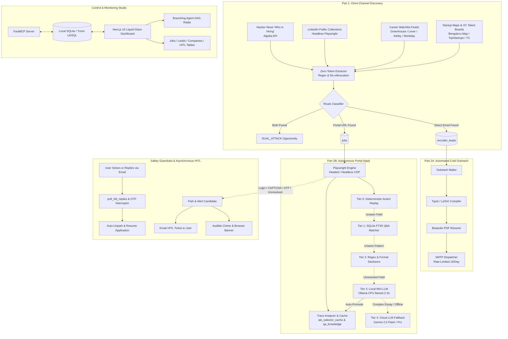

# ApplyPilot

**Autonomous Omni-Channel Job Discovery, Cold Outreach & Browser-Driven Application Agent**

[](https://www.python.org/downloads/)
[](https://nextjs.org/)
[](https://playwright.dev/)
[](https://modelcontextprotocol.io/)
[](https://ollama.com/)
[](tests/)
[](LICENSE)

ApplyPilot is an autonomous, multi-channel engineering hiring assistant and browser automation system. It executes the **Dual-Attack Strategy**: discovering open software engineering roles across social feeds, curated startup maps, and enterprise ATS boards, extracting direct founder and recruiter emails, dispatching tailored cold email pitches with compiled PDF resumes, and autonomously completing complex web application forms via a **5-Tier Zero-Token Learning Engine** featuring **local mini-LLM inference on CPU** (`llama3.2:1b`) and an **iOS-inspired Next.js 16 Liquid-Glass Dashboard**.

---

## 🏛️ System Architecture



---

## 🌟 Key Capabilities & Innovations

### 1. The Dual-Attack Strategy
Traditional job seekers submit portal applications that disappear into large resume queues. ApplyPilot executes a synchronized multi-vector approach:
- **Route 1 (`EMAIL_ONLY`)**: For social posts containing verified hiring manager or founder emails, compiles tailored resumes and dispatches high-conversion cold emails directly to decision-makers.
- **Route 2 (`PORTAL_ONLY`)**: For enterprise career portals, launches Playwright to automatically complete form fields with verified candidate facts.
- **Route 3 (`DUAL_ATTACK`)**: When both an official portal URL and a direct email exist, ApplyPilot simultaneously applies through the portal AND dispatches a concise email pitch confirming the application.

### 2. 5-Tier Zero-Token Learning Engine
Instead of spending expensive LLM tokens on routine inputs, ApplyPilot processes web forms through an escalating 5-tier architecture:
1. **Tier 0 (Deterministic Action Replay)**: Matches previously solved forms by field hash & canonical key; replays exact actions in milliseconds with 0 tokens.
2. **Tier 1 (SQLite FTS5 Matcher)**: Full-text lexical search across candidate knowledge base (`qa_knowledge`) for instant matches.
3. **Tier 2 (Regex & Heuristics)**: Static pattern compiler and unit transformers for phone numbers, salaries, dates, and citizenship booleans.
4. **Tier 3 (Local Mini LLM on CPU)**: When unseen screening questions or ambiguous dropdowns appear, prompts a local `llama3.2:1b` model running purely on CPU via Ollama (<1,500 token contextual slice from `candidate_vault.json`). Resolves fields in ~700ms with **0 MB VRAM** and **0 cloud API tokens**, then auto-promotes successful answers to Tier 1 SQLite memory.
5. **Tier 4 (Cloud Fallback LLM)**: Gracefully falls back to Gemini 2.0 Flash / GPT-4o only if local Ollama is offline or for extended essay prompts.

### 3. Real-Time CAPTCHA Detection & Audio Cues
When a Cloudflare Turnstile, reCAPTCHA, hCaptcha, or 2FA/OTP code is detected in headed mode:
- ApplyPilot alerts the candidate with audible sound cues (system audio + browser chime + terminal bell).
- Injects a real-time status banner into the browser window.
- Automatically resumes execution once the human or browser finishes the challenge.

### 4. Zero-Cookie Social Harvesting
ApplyPilot operates under a strict **Zero-Cookie Policy**:
- **LinkedIn Public Harvester**: Uses Playwright to monitor public guest collections (`/jobs/remote-software-engineer-jobs`) with **zero account credentials**, eliminating account ban risks.
- **Hacker News Algolia Harvester**: Queries the public Algolia API to analyze monthly "Ask HN: Who is Hiring?" threads, extracting verified founder emails (`founder@...`, `cto@...`, `hiring@...`) with zero rate limits.
- **Public ATS Feeds**: Directly queries official public keyless JSON endpoints for **Greenhouse** (`boards-api.greenhouse.io`), **Lever** (`api.lever.co`), **Ashby** (`api.ashbyhq.com`), and **Workday**.

### 5. Liquid-Glass Next.js 16 Dashboard
A modern command center built with Next.js 16, Tailwind CSS, and Turso/SQLite:
- **Agent Radar View**: Interactive SVG Directed Acyclic Graph (DAG) visualizing autonomous agent states, harvester executions, and pipeline telemetry in real-time.
- **Pipeline Workspaces**: Dedicated workspaces for Jobs, Leads, Companies, Applied Applications, Sources, and Human-in-the-Loop (HITL) tickets.
- **Profile Studio**: Manage candidate skills, story matrix, salary boundaries, and Q&A knowledge directly from the browser.

---

## 💻 Tech Stack

| Layer | Technologies Used | Purpose |
| :--- | :--- | :--- |
| **Language & Core Runtime** | Python 3.12+, `uv` | Core engine, dependency isolation, rapid execution |
| **Frontend Dashboard** | Next.js 16 (Turbopack), React 19, Tailwind CSS | Liquid-glass UI, real-time telemetry, agent radar DAG |
| **Browser Automation** | Playwright (Chromium), CDP | Form automation, session vaulting, public guest scraping |
| **Local AI Inference** | Ollama (`llama3.2:1b`), CPU-optimized | 100% offline, private, zero-token form Q&A resolution |
| **Cloud AI Fallbacks** | Google Gemini 2.0 Flash / 2.5 Pro, OpenAI | Resume tailoring, cover letter compilation, essay fallback |
| **Database & Search** | SQLite3, SQLite FTS5, Turso LibSQL | Local persistence, lead tracking, Q&A memory indexing |
| **Agent / Protocol** | FastMCP (`src/applypilot/mcp_server.py`) | Model Context Protocol server exposing 9 tools to AI IDEs |
| **Document Generation** | Typst, pdfLaTeX, JSON Resume | Deterministic compilation of tailored PDF resumes |
| **Email Protocols** | IMAP (OAuth/App Passwords), SMTP, MIME | HITL reply parsing, OTP interception, cold outreach |

---

## 📦 Directory Structure

```text
ApplyPilot/
├── src/applypilot/               # Core Python application package
│   ├── apply/                   # Playwright automation & form filling engine
│   │   ├── captcha_detector.py  # Turnstile, reCAPTCHA, hCaptcha detector
│   │   ├── human_input.py       # Humanized keystroke typing & delay jitter
│   │   ├── ocr_reader.py        # Visual OCR verification of form fields
│   │   ├── playwright_engine.py # Main Playwright low-AI execution engine
│   │   └── prompt.py            # ATS form inspection and field parsing
│   ├── career_resolver/         # Company career site & ATS feed resolvers
│   ├── discovery/               # Omni-channel job & recruiter harvesters
│   │   ├── ats_direct_feeds.py  # Direct keyless Greenhouse/Lever/Ashby APIs
│   │   ├── hackernews.py        # HN Algolia Who is Hiring harvester
│   │   ├── linkedin_guest.py    # Zero-cookie LinkedIn guest scraper
│   │   └── omni_orchestrator.py # Multi-source discovery coordinator
│   ├── hitl/                    # Asynchronous Human-in-the-Loop workflows
│   │   ├── audio.py             # Audible chimes and system notifications
│   │   ├── checkpoint.py        # Form DOM state serialization & recovery
│   │   ├── email_notifier.py    # Ticket dispatcher for blocked jobs
│   │   ├── email_reply_parser.py# IMAP reply poller & answer extractor
│   │   └── otp_interceptor.py   # Live OTP code interceptor
│   ├── learning/                # 5-Tier Zero-Token Learning Engine
│   │   ├── canonical_matcher.py # SQLite FTS5 lexical matching
│   │   ├── tier0_playbook.py    # Deterministic action replay cache
│   │   ├── tier1_semantic_qa.py # Normalized Q&A knowledge matcher
│   │   ├── tier2_heuristics.py  # Unit converters & regex pattern sanitizers
│   │   └── trace_analyzer.py    # Form trace analyzer & selector learner
│   ├── outreach/                # Automated cold email engine
│   │   └── mailer.py            # SMTP dispatcher with safety rate limits
│   ├── scoring/                 # Match scoring & resume tailoring
│   │   ├── cover_letter.py      # Bespoke cover letter synthesis
│   │   ├── scorer.py            # Role match evaluation (0-10)
│   │   └── tailor.py            # Tailored resume compiler
│   ├── social_discovery/        # Social dorking and recruiter extraction
│   ├── tracking/                # Application tracking & Gmail triage
│   ├── cli.py                   # Rich CLI interface (Typer)
│   ├── database.py              # SQLite CRUD & schema migrations
│   ├── llm.py                   # Multi-provider LLM client (Ollama/Gemini/OpenAI)
│   └── mcp_server.py            # FastMCP server exposing 9 tools
├── dashboard/                   # Next.js 16 iOS Liquid-Glass Control Center
│   ├── app/                     # App router pages (jobs, leads, radar, hitl, etc.)
│   ├── components/              # UI components, modals, and Agent DAG visualizer
│   └── lib/                     # Database client (Turso/SQLite) & NextAuth
├── config/                      # Candidate configuration & vault data
│   ├── candidate_vault.json     # Master candidate profile, stories & locked facts
│   └── sites.yaml               # Discovery targets and ATS configurations
├── docs/                        # Complete technical documentation
│   ├── guide/                   # Deep architectural guides (01 - 05)
│   └── specs/                   # Detailed specifications & design blueprints
├── scripts/                     # Helper utilities and candidate vault builders
│   ├── build_candidate_vault.py # Offline candidate vault compiler
│   └── harvest_job_data.py      # Standalone batch discovery script
├── tests/                       # Automated test suite (523 passing tests)
├── docker-compose.yml           # Multi-container Docker deployment
├── Dockerfile                   # Headless Playwright + Python runtime image
├── pyproject.toml               # Python project configuration & dependencies
├── package.json                 # Top-level workspace runner scripts
└── README.md                    # System documentation
```

---

## 🚀 Quickstart Guide

### 1. Installation

Clone the repository and install dependencies using `uv`:

```bash
git clone https://github.com/Sameer-Bagul/ApplyPilot.git
cd ApplyPilot

# Sync Python virtualenv
uv sync

# Install Playwright browser binaries
uv run playwright install chromium
```

### 2. Environment Configuration

Copy the example environment template:

```bash
cp .env.example .env
```

Edit `.env` to configure your settings:
- **Local Mini LLM (Tier 3)**:
  ```env
  OLLAMA_HOST=http://localhost:11434
  OLLAMA_MODEL=llama3.2:1b
  OLLAMA_NUM_GPU=0
  OLLAMA_NUM_THREADS=8
  ```
- **Cloud Fallback LLM (Optional)**:
  ```env
  GEMINI_API_KEY=your_gemini_api_key
  ```
- **Email Notifications & Cold Outreach**:
  ```env
  SMTP_HOST=smtp.gmail.com
  SMTP_PORT=587
  SMTP_USER=you@gmail.com
  SMTP_PASS=your_app_password
  APPLYPILOT_USER_EMAIL=you@gmail.com
  ```

### 3. Start Local Mini LLM (Ollama CPU)

Ensure Ollama is running in CPU mode:

```bash
CUDA_VISIBLE_DEVICES="" OLLAMA_NUM_GPU=0 ollama serve
```

Pull the lightweight `llama3.2:1b` model (only ~1.3 GB, runs in ~700ms on CPU):

```bash
ollama pull llama3.2:1b
```

### 4. Launch Next.js Dashboard

Start the Next.js control center:

```bash
npm run dashboard
# Dashboard opens at http://localhost:3000
```

Or run everything (backend workers + dashboard) simultaneously:

```bash
./run_all.sh
```

---

## 💻 CLI Commands

### 1. Omni-Channel Discovery (`Part 1`)
Harvest thousands of active jobs and direct founder/recruiter emails:

```bash
# Run discovery across Hacker News, LinkedIn, FreeHire, and public ATS boards
uv run python scripts/harvest_job_data.py

# Or run discovery via the CLI orchestrator
uv run python -m applypilot discover-all --limit 50
```

### 2. Automated HR & Founder Cold Outreach (`Part 2A`)
Send personalized pitches with attached tailored resumes to discovered hiring managers:

```bash
# Preview cold email queue without sending
uv run python -m applypilot outreach --dry-run

# Dispatch up to 10 cold emails (rate-limited safely)
uv run python -m applypilot outreach --limit 10
```

### 3. Playwright Autonomous Applications (`Part 2B`)
Launch Playwright with the 5-Tier Zero-Token Learning Engine:

```bash
# Apply to a specific ATS URL in headed mode (for visual review)
uv run python -m applypilot apply --url "https://jobs.ashbyhq.com/company/role" --headed

# Run autonomous application queue with parallel workers
uv run python -m applypilot apply --workers 2 --min-score 7
```

### 4. End-to-End Daily Automation
Execute the complete daily hiring pipeline:

```bash
# Runs Discovery -> Outreach -> Application -> HITL Polling -> Tracking
uv run python -m applypilot run-daily
```

### 5. FastMCP Server Integration
Connect ApplyPilot to Claude Desktop, Antigravity, or Cursor via Model Context Protocol:

```bash
uv run python -m applypilot mcp
```

Exposed MCP Tools:
- `discover_opportunities`: Initiates multi-channel discovery.
- `get_recruiter_leads`: Queries filtered founder and recruiter leads.
- `send_outreach_emails`: Dispatches rate-limited cold outreach emails.
- `resolve_company_career_portal`: Resolves official career pages and ATS endpoints.
- `poll_hitl_email_replies`: Checks incoming user answers and OTP codes.
- `get_qa_knowledge`: Searches SQLite FTS5 for saved screening questions.
- `get_application_stats`: Retrieves real-time pipeline funnel metrics.

---

## 🧪 Testing

ApplyPilot includes a comprehensive automated test suite with **523 passing tests**:

```bash
# Run complete test suite
uv run pytest -q --tb=short

# Run specific functional suites
uv run pytest tests/test_5tier_learning.py
uv run pytest tests/test_playwright_engine.py
uv run pytest tests/test_social_discovery.py
uv run pytest tests/test_mcp_server.py
```

---

## 🔒 Security & Privacy Guarantees

1. **Zero-Cookie Social Policy**: ApplyPilot **never** asks for or stores personal LinkedIn, X, or social media session cookies.
2. **Safe Outreach Rate Limiting**: The cold mailer strictly caps outbound email at 15 emails per day with randomized intervals.
3. **No Fact Hallucination**: The resume tailoring and Q&A engines strictly adhere to facts stored in `candidate_vault.json`.
4. **Local Data Sovereignty**: All credentials, job statuses, traces, and Q&A answers are persisted locally in SQLite (`~/.applypilot/applypilot.db`).

---

## 📄 License

Licensed under the [AGPL-3.0 License](LICENSE).
