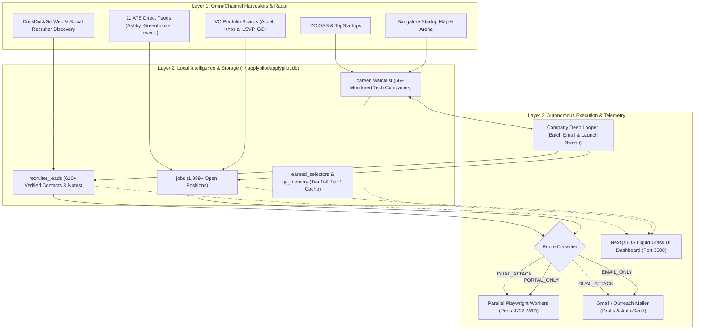

# System Architecture & Core Pipeline Overview

ApplyPilot is an autonomous job acquisition platform designed to systematically discover tech companies, track their job openings in real-time across ATS platforms and VC talent boards, enrich 8 to 12+ verified recruiter and founder emails per company, and execute high-conversion **Dual-Attack** applications (combining ATS portal submissions with personalized cold recruiter outreach).

---

## 1. High-Level Architecture

The platform operates across three logical execution layers:

---

## 2. The Three-Tier Execution Hierarchy

To achieve maximum reliability while minimizing token and compute costs, ApplyPilot enforces a strict 3-tier hierarchy:

1. **Tier 0 (Deterministic, Zero-Token Automation)**:
   - Direct HTTP API feeds for 11 Applicant Tracking Systems (ATS) with zero browser overhead.
   - Cached form selector playbook (`learned_selectors`) for Greenhouse, Lever, Ashby, Workday, etc.
   - Exact-match profile field resolution (Name, Email, Phone, LinkedIn, Resume path).
   - Zero LLM tokens consumed.
2. **Tier 1 (Semantic Reasoning & Adaptation)**:
   - Semantic Q&A resolution for custom ATS screening questions (`qa_pairs`).
   - Resume tailoring and fit scoring against candidate profile using lightweight LLM calls.
   - Automated synthesis of personalized $\le 280$-character LinkedIn connection notes.
   - DuckDuckGo / web search parsing for real recruiter names and verified email synthesis.
3. **Tier 2 (Autonomous Form Filling & Email Delivery)**:
   - Parallel Playwright browser workers operating isolated headless/headful Chrome instances via Chrome DevTools Protocol (CDP).
   - Dual-Attack outreach: simultaneously submits the formal ATS job application while dispatching a hyper-personalized email directly to the verified recruiter or founder citing the submission.
   - Asynchronous Email HITL (Human-in-the-Loop) reply tracker that polls Gmail for user approvals on unprecedented screening questions or 2FA OTP codes.

---

## 3. Database Schema Overview (`~/.applypilot/applypilot.db`)

The local SQLite database acts as the single source of truth for all components:

| Table | Purpose | Key Columns |
| :--- | :--- | :--- |
| `jobs` | Master registry of all discovered openings | `url` (PK), `title`, `company`, `location`, `site`, `fit_score`, `execution_route`, `discovered_at`, `state` |
| `career_watchlist` | Monitored tech startups and corporate hubs | `company_id` (PK), `company_name`, `official_domain`, `careers_page_url`, `ats_provider`, `priority_tier`, `is_vip`, `hr_contacts_json`, `open_roles_count` |
| `recruiter_leads` | Verified talent partners, founders, and inboxes | `lead_id` (PK), `company_name`, `contact_name`, `contact_email`, `role_title`, `contact_type`, `contact_linkedin_url`, `linkedin_connection_note`, `execution_route` |
| `learned_selectors` | Self-healing Tier 0 form field mapping cache | `selector_id` (PK), `ats_type`, `url_pattern`, `field_name`, `css_selector`, `success_count`, `failure_count` |
| `qa_pairs` | Learned candidate answers to screening questions | `qa_id` (PK), `question_text`, `answer_text`, `category`, `confidence`, `last_used_at` |
| `apply_traces` | Audit trail of form field interactions | `trace_id` (PK), `job_url`, `ats_type`, `step_index`, `action`, `selector`, `status`, `duration_ms` |

---

## 4. Next.js Liquid-Glass Dashboard Integration

The dashboard (`dashboard/`) runs independently on port `3000` or inside the container stack:
- Uses Node.js native `node:sqlite` to query `~/.applypilot/applypilot.db` with zero external build dependencies.
- Features real-time API endpoints:
  - `/api/stats`: High-level metrics, funnel routes breakdown, top ATS engines, and recent discoveries.
  - `/api/jobs`: Searchable, paginated jobs with execution route badges.
  - `/api/companies`: Watchlist startups with VIP filters and open roles count.
  - `/api/companies/drilldown`: Full company drawer showing all 8-12 verified recruiter emails, 1-click email copy, bulk outreach composition, and active jobs.
  - `/api/leads`: Searchable recruiter and founder contacts with 1-click email and LinkedIn note copy.

