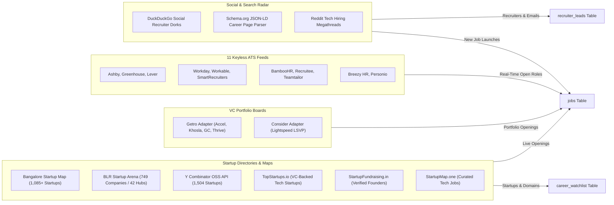

# Data Sources & Discovery Pipeline

ApplyPilot continuously ingests job postings and tech startup metadata across multiple high-signal channels. This document details where every piece of data originates, how it is ingested, and how duplicate records are prevented.

---

## 1. Data Ingestion Architecture

---

## 2. Directory Sources Detail

### A. Bangalore Startup Map (`bangalorestartupmap.com`)
- **Module**: `src/applypilot/discovery/bangalore_map_harvester.py`
- **Mechanism**: Fetches Next.js React Server Component (RSC) payload (`_rsc`) containing the full unpaginated JSON database of 1,085+ startups.
- **Data Extracted**:
  - Company name, slug, official domain, website URL, and sector (AI, SaaS, Deeptech, Fintech).
  - Operating hubs (Koramangala, Indiranagar, HSR Layout, Whitefield).
  - Open role counts and direct application URLs.
  - Founder names and LinkedIn profiles.

### B. BLR Startup Arena (`blrstartuparena.com`)
- **Module**: `src/applypilot/discovery/blr_arena_harvester.py`
- **Mechanism**: Scrapes 42 Bangalore tech localities (Koramangala, Domlur, Bellandur, Electronic City, etc.).
- **Data Extracted**:
  - 749 companies categorized by physical neighborhood and funding stage.
  - Specific engineering team breakdown (e.g. backend: 12, ML/AI: 8, DevOps: 6).
  - Street address and physical office headquarters.

### C. Y Combinator Public API (`yc-oss/api`)
- **Module**: `src/applypilot/discovery/yc_harvester.py`
- **Mechanism**: Ingests direct JSON dump from YC OSS API (`https://raw.githubusercontent.com/yc-oss/api/main/companies.json`).
- **Data Extracted**:
  - 1,504 actively hiring YC companies.
  - Filtered by `locations: ["India", "Bengaluru", "Remote"]` and batch (`W24`, `S24`, `W25`, etc.).
  - Direct founder names, team sizes, and company descriptions.

### D. TopStartups.io (`topstartups.io/jobs`)
- **Module**: `src/applypilot/discovery/topstartups_harvester.py`
- **Mechanism**: Scrapes VC-backed curated startup lists (backed by Sequoia, Founders Fund, Khosla, Benchmark, YC).
- **Data Extracted**:
  - Startup valuation, total capital raised, and primary VC backer.
  - Direct ATS links (Greenhouse, Lever, Ashby) for immediate keyless ingestion.

### E. VC Portfolio Talent Networks (Getro & Consider)
- **Module**: `src/applypilot/discovery/vc_portfolio_harvester.py`
- **Mechanism**: Direct REST API integration with portfolio talent platforms:
  - **Getro Boards**:
    - Accel: `https://accel.getro.com/api/v1/jobs`
    - Khosla Ventures: `https://khosla-ventures.getro.com/api/v1/jobs`
    - General Catalyst: `https://general-catalyst.getro.com/api/v1/jobs`
    - Thrive Capital: `https://thrive-capital.getro.com/api/v1/jobs`
  - **Consider Board**:
    - Lightspeed Venture Partners (LSVP): `https://boards.consider.com/lightspeed-venture-partners/api/jobs`
- **Data Extracted**:
  - Real-time job title, portfolio company name, location, and direct application URL.

### F. StartupFundraising.in
- **Module**: `src/applypilot/discovery/startupfundraising_harvester.py`
- **Mechanism**: Scrapes recently funded Indian tech startups.
- **Data Extracted**:
  - Founder names with verified LinkedIn profile URLs.
  - Automatically synthesizes $\le 280$-character personalized LinkedIn connection notes.

### G. StartupMap.one
- **Module**: `src/applypilot/discovery/startupmap_one_harvester.py`
- **Mechanism**: Scrapes curated Bangalore startup job openings (`startupmap.one/jobs/bangalore`).
- **Data Extracted**:
  - Role title, company name, location, and apply link.

---

## 3. Direct Keyless 11-ATS Feeds

ApplyPilot connects directly to 11 major Applicant Tracking Systems via public, keyless APIs. No browser automation or login credentials are required for role ingestion:

| ATS Provider | Endpoint / Feed URL Pattern | Format |
| :--- | :--- | :--- |
| **Ashby** | `https://api.ashbyhq.com/posting-api/job-board/{board_token}` | JSON REST / GraphQL |
| **Greenhouse** | `https://boards-api.greenhouse.io/v1/boards/{board_token}/jobs` | JSON REST |
| **Lever** | `https://api.lever.co/v0/postings/{board_token}?mode=json` | JSON REST |
| **Workday** | `https://{tenant}.wd3.myworkdayjobs.com/wday/cxs/{tenant}/{site}/jobs` | JSON POST (CXS) |
| **Workable** | `https://apply.workable.com/api/v3/accounts/{slug}/jobs` | JSON POST |
| **SmartRecruiters**| `https://api.smartrecruiters.com/v1/companies/{slug}/postings` | JSON REST |
| **BambooHR** | `https://{slug}.bamboohr.com/careers/list` | JSON REST |
| **Recruitee** | `https://{slug}.recruitee.com/api/offers/` | JSON REST |
| **Teamtailor** | `https://api.teamtailor.com/v1/jobs` (or `/feed/json`) | JSON Feed |
| **Breezy HR** | `https://{slug}.breezy.hr/json` | JSON Feed |
| **Personio** | `https://{slug}.jobs.personio.de/xml` | XML / JSON Stream |

---

## 4. Change Detection & Custom Careers Pages

For companies using custom landing pages without standard ATS subdomains:
- **Module**: `src/applypilot/career_resolver/jsonld_parser.py`
- **Mechanism**:
  - Sends HTTP conditional `GET` requests using `If-None-Match` (ETag) and `If-Modified-Since`.
  - Calculates SHA-256 content hashes of the rendered HTML body.
  - If content hash changes, parses Schema.org `JobPosting` microdata embedded within `<script type="application/ld+json">` blocks.
  - Extracts exact job titles, hiring organization, base salary, physical address, and application direct links.
