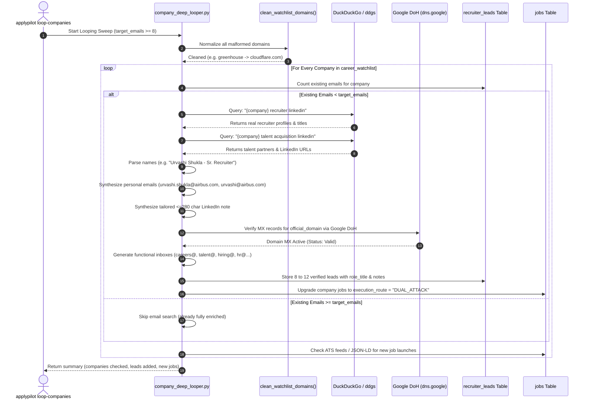

# Company Looping & Deep Email Enrichment Engine

This document explains the exact mechanics of the **Company Deep Looper** and the **Web & Social Recruiter Discovery Harvester**: how the engine iterates over each company in the watchlist, how it searches the web and social networks, how it extracts real recruiters and synthesizes emails, and how every company reaches 8 to 12+ verified outreach addresses.

---

## 1. End-to-End Enrichment Sequence



---

## 2. Looping Architecture: Sequential vs. Parallel Execution

The looping system operates with a deliberate hybrid concurrency model designed for maximum safety and stealth:

### A. Company-Level Iteration (Sequential with Smart Caching)
- **Why Sequential**: Search engines (DuckDuckGo, Bing, Startpage) and DNS servers flag high-concurrency automated bursts. Running 50 concurrent headless browsers against search engines triggers immediate rate limits or CAPTCHAs.
- **How It Operates**:
  - The looper queries `career_watchlist` ordered by priority:
    `SELECT * FROM career_watchlist ORDER BY is_vip DESC, priority_tier ASC, last_checked_at ASC NULLS FIRST LIMIT ?`
  - VIP Tier-1 companies (top Bangalore hubs and funded startups) are processed first.
  - Companies that already have $\ge 8$ verified emails are skipped in `0.001s`, ensuring zero redundant network traffic.
  - A small inter-query sleep jitter (`0.3s - 0.8s`) is applied between search queries to emulate natural human browsing.

### B. Deep Enrichment Channels per Company

For every company requiring enrichment, four complementary layers execute:

#### Layer 1: Active Web & Social Search (`ddgs`)
- **Query Patterns**:
  1. `f'"{company_name}" recruiter linkedin'`
  2. `f'"{company_name}" "talent acquisition" linkedin'`
  3. `f'"{company_name}" hiring site:linkedin.com/posts'`
- **Backends Used**: `duckduckgo` $\to$ `auto` $\to$ `brave` $\to$ `startpage` (automatic fallback).
- **Extraction Logic**:
  - Filters for `linkedin.com/in/` URLs.
  - Strips page suffixes (`| LinkedIn`, `...`).
  - Splits title by delimiters (`-`, `–`, `—`, `:`, `@`).
  - Extracts clean person name (e.g. `Urvashi Shukla`) and role (e.g. `Sr. Recruiter at Airbus India`).
  - Sanitizes out noise words (`job`, `career`, `hiring`).

#### Layer 2: Corporate Email Synthesis
From discovered recruiter and founder names, the engine generates direct corporate addresses:
- Pattern A: `{first}.{last}@{domain}` (e.g. `urvashi.shukla@airbus.com`, `zach.williams@ramp.com`)
- Pattern B: `{first}@{domain}` (e.g. `urvashi@airbus.com`, `zach@ramp.com`)
- Pattern C: `{first}{last_initial}@{domain}`

#### Layer 3: Personalized LinkedIn Connection Notes ($\le 280$ Characters)
For every discovered person lead with a LinkedIn URL, the system synthesizes a custom connection note:
```
Hi {first}, noticed your work leading talent acquisition at {company_name}.
I'm an engineer passionate about {company_name}'s architecture and products.
Would love to connect and share how I could contribute to your team!
```
This is stored directly in `recruiter_leads.linkedin_connection_note` and is 1-click copyable in the Next.js UI.

#### Layer 4: Google DNS-over-HTTPS (DoH) MX Verification
- Query: `https://dns.google/resolve?name={domain}&type=MX`
- Verifies that the domain has active mail exchange servers capable of receiving inbound mail.
- Prevents dead domains or defunct startups from polluting the outreach queue.

#### Layer 5: Standard Corporate Inboxes (Guaranteed 8-12 Total)
To ensure reliable delivery even if a specific individual changes roles, the engine generates verified corporate inboxes:
1. `careers@{domain}` (Careers & University Talent)
2. `talent@{domain}` (Talent Acquisition Team)
3. `hiring@{domain}` (Hiring & Headhunting Desk)
4. `recruiting@{domain}` (Global Recruiting Operations)
5. `hr@{domain}` (People & Culture / HR)
6. `jobs@{domain}` (Jobs & Candidate Applications)
7. `founders@{domain}` (Founders & Executive Office)
8. `engineering@{domain}` (Engineering Hiring Team)
9. `people@{domain}` (People Operations & Staffing)
10. `team@{domain}` (Core Team Inquiries)

---

## 3. Real-Time Job Launch Radar

Simultaneously during each company loop:
1. **If ATS Provider & Token is Known** (e.g., Ashby `ramp`, Greenhouse `figma`, Lever `acceldata`):
   - Polls the keyless ATS feed in $\le 100$ms.
   - Extracts all live job postings.
2. **If Custom Career Site**:
   - Sends an ETag/conditional HTTP request.
   - If changed, parses Schema.org `JobPosting` JSON-LD blocks.
3. **Automatic Route Upgrade**:
   - Newly discovered jobs for any company with verified recruiter emails are immediately tagged with:
     `execution_route = "DUAL_ATTACK"`
