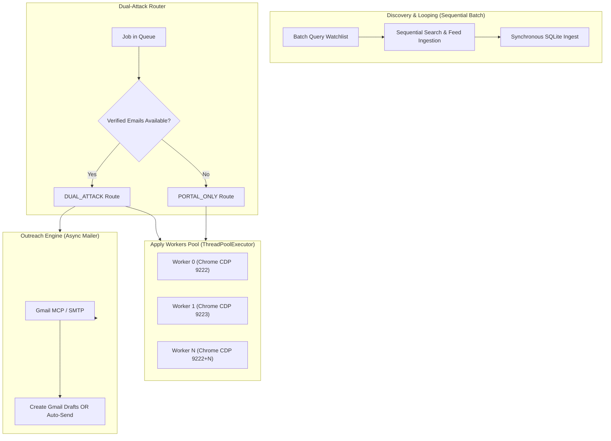
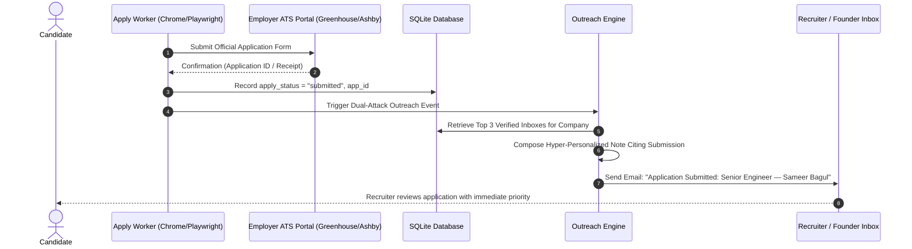

# Agent Execution & Dual-Attack Concurrency Model

This document explains the runtime agent execution model: how workers run concurrently, how browser processes are managed, what the **Dual-Attack** strategy does, and how the Human-in-the-Loop (HITL) system resolves screening questions and OTP codes asynchronously.

---

## 1. Concurrency Architecture: Sequential vs. Parallel

ApplyPilot differentiates between **I/O-bound discovery** and **compute-heavy browser execution**:

| Component | Execution Model | Concurrency Control |
| :--- | :--- | :--- |
| **Directory Harvesters** | Sequential Batch | Single thread, sequential HTTP with connection pooling (`httpx.Client`) |
| **Web & Social Recruiter Search** | Sequential with Jitter | Single thread per company sweep, `0.3-0.8s` jitter between queries |
| **ATS Feeds Polling** | High-Speed Async / Pool | Keyless REST requests completed in `< 100ms` per board |
| **Apply Execution** | **True Parallel Multi-Worker** | `ThreadPoolExecutor(max_workers=N)`, isolated Chrome instances, per-worker CDP ports |
| **Email Outreach** | Asynchronous / Batch | Batch queue processing with Gmail drafts or rate-limited auto-send |

---

## 2. Multi-Worker Chrome CDP Isolation (`src/applypilot/apply/chrome.py`)

When running `applypilot apply --workers N`:
1. **Isolated Chrome Profiles**:
   - Worker 0 launches Chrome on CDP port `9222` with user-data directory `chrome-workers/worker_0`.
   - Worker 1 launches Chrome on CDP port `9223` with user-data directory `chrome-workers/worker_1`.
   - Each worker operates in complete isolation: separate cookies, separate DOM storage, and independent session memory.
2. **Anti-Bot & Stealth Engine**:
   - Utilizes `patchright` (stealth-forked Playwright) with disabled automation flags (`--disable-blink-features=AutomationControlled`).
   - Native OS window flags prevent focus stealing while the user is working.
3. **Form Resolution Hierarchy**:
   - **Step 1 (Tier 0 Playbook)**: Detects ATS provider (Greenhouse, Lever, Ashby, Workday). Checks `learned_selectors` cache. If field selectors match, executes zero-token autofill in $< 500$ms.
   - **Step 2 (Semantic Q&A)**: For custom screening questions (e.g. *"Are you authorized to work in India?"*, *"Notice period?"*), checks `qa_pairs` memory.
   - **Step 3 (HITL Escalation)**: If an answer cannot be determined with $\ge 85\%$ confidence, parks the job as `needs_human` and dispatches an email notification to the candidate.

---

## 3. The Dual-Attack Strategy

Traditional job bots either spam portals (low conversion rate, resume gets lost in 1,000+ applicant stacks) or send cold emails without submitting an official application (recruiter has no legal application record in their ATS).

ApplyPilot's **Dual-Attack** strategy executes both vectors in tandem:

### The Dual-Attack Outreach Message:
> **Subject**: Application Submitted: Senior Software Engineer — Sameer Bagul  
> **Body**:  
> *"Hi [Recruiter/Founder Name],*  
> *I just officially submitted my application for the Senior Engineer role on your career portal (Confirmation ID: #12345).*  
> *Given your focus on distributed systems and high-scale Python/Rust pipelines at [Company], I wanted to briefly highlight my background building autonomous agents and low-latency systems. My resume is attached for quick review.*  
> *Best regards,*  
> *Sameer Bagul"*

---

## 4. Asynchronous Email HITL & OTP Resolution

When an ATS platform requires two-factor authentication (e.g. Workday sending a 6-digit verification code to the candidate's email) or poses an unknown screening question:
1. **Zero-Stall Pipeline**:
   - The worker does NOT halt the entire pipeline.
   - It records the question or triggers `dispatch_hitl_email_and_park()`.
   - The job state transitions to `needs_human` / `waiting_otp`.
   - The worker immediately picks up the next job from the queue!
2. **Background Sync (`applypilot track --poll-hitl`)**:
   - The background tracker daemon polls Gmail periodically.
   - When the candidate replies to the email ticket (or the OTP arrives), the tracker extracts the answer, updates `qa_pairs` memory, and unparks the job.
   - The next run of `applypilot apply` resumes the job right where it left off.
