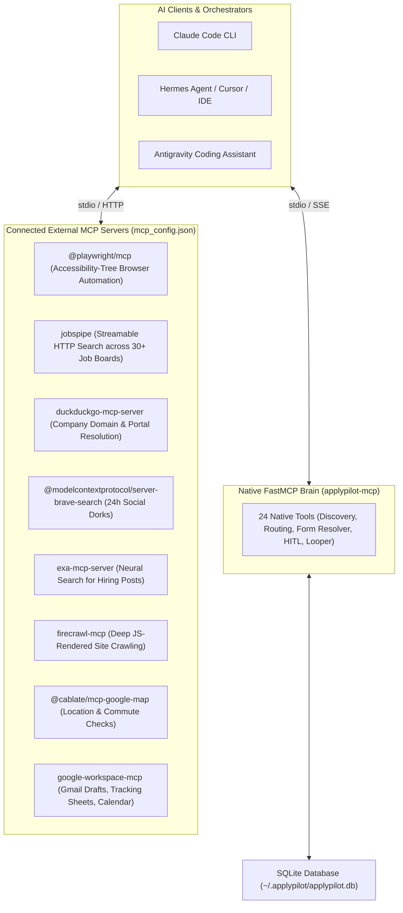

# Model Context Protocol (MCP) Topology & Tool Inventory

ApplyPilot exposes its internal capabilities as a standardized **FastMCP server** while connecting to specialized external MCP servers for browser automation, web search, job feeds, and cloud workspace management.

---

## 1. MCP Topology Overview

---

## 2. Connected MCP Servers Catalog

| Server Name | Transport | Purpose | When It Is Invoked |
| :--- | :--- | :--- | :--- |
| `applypilot-mcp` | `uv run applypilot mcp` (stdio) | Core ApplyPilot pipeline brain, database queries, and learning engine | Invoked whenever an AI agent inspects pipeline state, discovers jobs, or triggers actions |
| `playwright` | `npx -y @playwright/mcp@latest` | Accessibility-tree browser automation for complex multi-step forms | Invoked during multi-step ATS form navigation when visual or interactive form filling is required |
| `jobspipe` | `https://mcp.jobspipe.dev/mcp` (HTTP) | Streamable search across 30+ job boards and Greenhouse/Lever feeds | Invoked for broad discovery sweeps across remote and global postings |
| `duckduckgo` | `uvx duckduckgo-mcp-server` | Keyless company domain and careers portal resolution | Invoked to resolve missing official domains or check company URLs |
| `brave-search` | `npx -y @modelcontextprotocol/server-brave-search` | Time-bounded social search for LinkedIn and X hiring posts | Invoked for fresh past-24h social hiring announcements |
| `exa` | `npx -y exa-mcp-server` | Neural search for founder announcements | Invoked for semantic queries on stealth hiring rounds |
| `firecrawl` | `npx -y firecrawl-mcp` | JS-rendered custom career site extraction | Invoked on JavaScript-heavy single-page career portals |
| `google-maps` | `npx -y @cablate/mcp-google-map` | Physical hub and neighborhood distance checks | Invoked when checking candidate commute to Bangalore hubs |
| `google-workspace`| `uvx google-workspace-mcp` | Gmail drafts, tracking spreadsheets, and interview calendar | Invoked when syncing email HITL replies or creating outreach drafts |

---

## 3. ApplyPilot FastMCP Native Tools Inventory (24 Tools)

The native server (`src/applypilot/mcp_server.py`) registers the following tools:

### Discovery & Directory Harvesters
1. `import_bangalore_startup_map`: Ingests tech startups and roles from Bangalore Startup Map.
2. `harvest_blr_arena`: Scrapes tech companies categorized across 42 Bangalore tech localities.
3. `harvest_yc_startups`: Ingests hiring startups from Y Combinator's public API.
4. `harvest_topstartups`: Scrapes VC-backed curated startup postings with ATS links.
5. `harvest_vc_portfolio_boards`: Ingests jobs across Accel, Khosla, Lightspeed, GC, and Thrive talent boards.
6. `import_startupfundraising_founders`: Scrapes funded startup founders and generates connection notes.
7. `import_startupmap_one_jobs`: Ingests curated Bangalore startup jobs.
8. `harvest_all_startup_directories`: Orchestrated sweep across all 7 directories in a single call.
9. `discover_all_channels`: Discovers jobs across Reddit, social search dorks, and career feeds.
10. `discover_and_score_jobs`: One-step discovery and AI match scoring based on role and location filters.
11. `resolve_company_career_portal`: Resolves company name to official career page and ATS board token.

### Deep Company Looping & Enrichment
12. `loop_and_enrich_watchlist_companies`: Sweeps career watchlist to maximize verified emails and capture open roles.

### Form Filling & Tier 0 Self-Healing
13. `resolve_form_fields`: Matches candidate profile deterministically against form fields before invoking an LLM.
14. `record_learned_mapping`: Caches verified CSS selectors into the Tier 0 playbook (`learned_selectors`).
15. `run_post_execution_learner`: Analyzes apply trace telemetry and promotes high-confidence selectors.

### Scoring, Tailoring & Application
16. `score_and_tailor_queue`: Retrieves scored jobs meeting minimum fit thresholds and prepares tailored resumes.
17. `execute_portal_applications`: Submits ready portal applications using the zero-token Playwright engine.
18. `execute_hr_outreach`: Dispatches personalized cold email outreach to verified recruiters and founders.

### Human-in-the-Loop (HITL) & Memory
19. `query_candidate_memory`: Semantic lookup across candidate Q&A pairs for custom screening questions.
20. `escalate_to_email_hitl`: Dispatches an email notification to the candidate with unanswered questions and parks the job.
21. `trigger_email_hitl`: Alternative trigger for email notifications on blocking form questions.
22. `sync_email_hitl_replies`: Polls Gmail for user replies to pending tickets and requeues jobs.
23. `sync_email_replies_and_unpark`: Synchronizes email replies, updates Q&A memory, and transitions jobs to ready.
24. `fetch_ats_otp_code`: Intercepts and retrieves 2FA OTP codes sent by employers (e.g. Workday verification).

